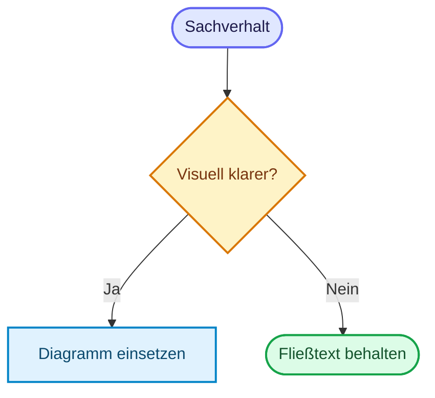

# Markdown Template Guide
{: .no_toc }

> **Vorlage und Regeln für Markdown-Dateien in `docs/` nach dem verbindlichen Doku-Standard**

---

# Inhaltsverzeichnis
{: .no_toc .text-delta }

1. TOC
{:toc}

---

## Ziel und Geltungsbereich

Diese Datei übersetzt den verbindlichen Standard aus `_docs/Dokument_Standard.md` in eine praktische Arbeitsvorlage für `GenAI/docs/`. Maßgeblich bleibt immer der Standard selbst. Diese Guide-Datei konkretisiert ihn für Jekyll, just-the-docs und die vorhandene Projektstruktur.

---

## Grundprinzip

Für alle Dokumente in `docs/` gilt: **Substanz vor Struktur**. Formatierung hilft beim Lesen, ersetzt aber keinen präzisen Text. Ein sauber formulierter Absatz ist fast immer besser als eine Kette aus Bullet Points.

Aufzählungen werden nur eingesetzt, wenn echte Parallelstruktur vorliegt. Abschnitte mit zusammenhängender Argumentation bleiben Fließtext. Aussagen wie "praxisorientiert", "ganzheitlich" oder "state of the art" werden vermieden, wenn sie nicht durch ein Beispiel oder einen überprüfbaren Beleg gedeckt sind.

Personalpronomen werden vermieden. Statt "Sie prüfen" oder "du findest" werden unpersönliche Formulierungen verwendet, etwa "Vor dem Start wird geprüft" oder "Die Checkliste findet sich weiter unten".

**Ausnahme Legal-Seiten:** In `14-rechtliches/index.md`, `impressum.md`, `datenschutz.md` und `haftungsausschluss.md` bleibt die "Sie"-Form erhalten. Gesetzliche Texte folgen der Rechtssprache; navigationsbezogene Sätze in der Rechtliches-Indexseite (z. B. "finden Sie im Footer") sind Teil dieser Konvention.

---

## Standard-Template für Inhaltsseiten

Diese Vorlage gilt für inhaltliche Dokumente in den nummerierten Bereichen `02-orientierung/` bis `13-ressourcen/`.

````markdown
---
layout: default
title: Titel des Dokuments
parent: Übergeordnete Seite
description: Prägnanter Beschreibungstext für Navigation und SEO
has_toc: true
---

# Titel des Dokuments
{: .no_toc }

> **Prägnanter Beschreibungstext für Navigation und SEO**

---

# Inhaltsverzeichnis
{: .no_toc .text-delta }

1. TOC
{:toc}

---

## Erstes Kapitel

Hier steht zusammenhängender Text. Bullet Points nur dann, wenn mehrere wirklich gleichwertige Punkte nebeneinanderstehen.

---

## Zweites Kapitel

Hier folgt der eigentliche Inhalt.

---

## Abgrenzung zu verwandten Dokumenten

| Dokument | Frage |
|---|---|
| Verwandtes Dokument (`./verwandtes-dokument.html`) | Worum geht es dort? |

---

## Callouts und Mermaid

### Callouts

Im Projekt wird GitHub-Alert-Syntax verwendet. Der Titel nach dem Alert-Typ ist Pflicht.

```markdown
> [!NOTE] Kontext<br>
> Ergänzende Information, die den Haupttext nicht unterbrechen soll.

> [!WARNING] Einschränkung<br>
> Bekannte Fehlerquelle oder wichtige Grenze.
```

Callouts heben einzelne Hinweise hervor, die sich sinnvoll vom Lesefluss absetzen. Eine feste Höchstzahl pro Abschnitt gibt es nicht; entscheidend ist, dass die Hervorhebungen Orientierung schaffen.

### Mermaid

Mermaid wird nur eingesetzt, wenn ein Zusammenhang visuell klarer wird als im Fließtext oder in einer Tabelle. Geeignet sind Entscheidungslogik, Zustandswechsel, Sequenzen und Architekturübersichten. `sequenceDiagram` kann mit `autonumber` nummeriert werden, wenn die Nummern den Ablauf leichter referenzierbar machen.

Das Farbschema (`theme: base` mit `themeVariables`) ist global in `_includes/head_custom.html` gesetzt, ein Init-Block pro Diagramm entfällt. Jedes `flowchart`-/`graph`-Diagramm muss farblich aufbereitet sein und färbt Knoten ausschließlich über `classDef` und `class` (`default`, `input`, `metric`, `output`, `target`, `stop`), nie über einzelne `style`-Zeilen. `sequenceDiagram`, `stateDiagram-v2` und `mindmap` kommen ohne `classDef` aus. Ausnahme: Ein Vergleich zweier Subgraphen darf `style` mit Palette-Hexwerten nutzen. Subgraph-Titel werden mit `<b>` gesetzt, z. B. `subgraph ID["<b>Titel</b>"]`. Palette und Begründung: `_docs/Mermaid_Best_Practices.md`.

````markdown

````

---

**Version:** 1.1<br>
**Stand:** Oktober 2026<br>
**Kurs:** Generative KI. Verstehen. Anwenden. Gestalten.
