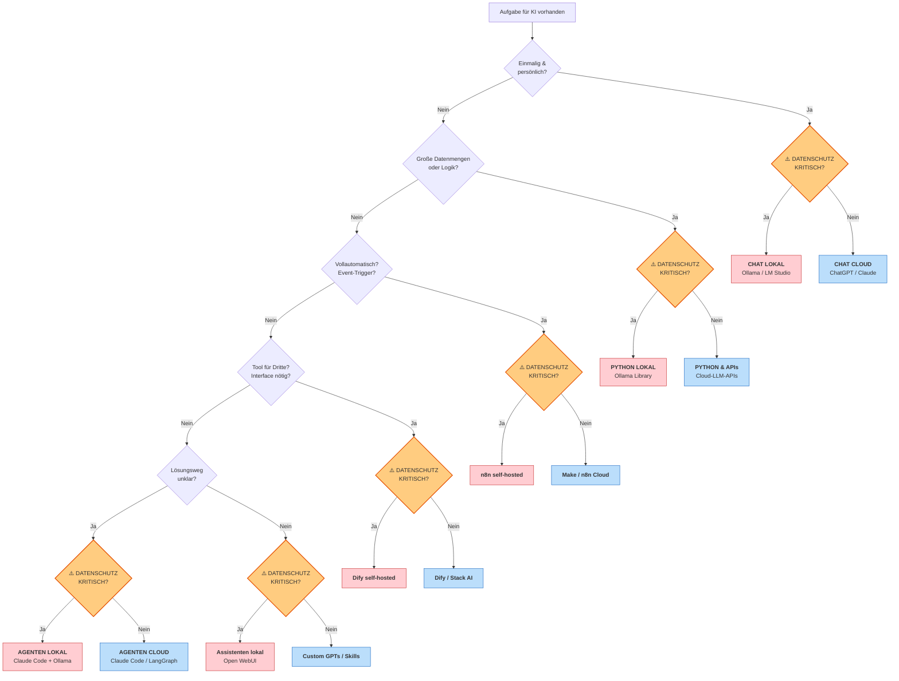

# Aufgabenklassen & Lösungswege 
{: .no_toc }

> **Die Aufgabe bestimmt das Tool**         
> Wie sich für konkrete Aufgaben der richtige GenAI-Lösungsweg finden lässt – von Chat über Automation bis hin zu Agenten-Systemen

---

# Inhaltsverzeichnis
{: .no_toc .text-delta }

1. TOC
{:toc}

---

## Intro

Wer heute mit generativer Künstlicher Intelligenz (GenAI) arbeiten möchte, steht vor einer verwirrenden Vielfalt an Möglichkeiten: ChatGPT nutzen? Python-Code schreiben? Automation-Tools einsetzen? Diese Frage ist nicht trivial, denn die falsche Wahl kostet Zeit, Geld und Nerven.

Die gute Nachricht: Es gibt eine Logik dahinter. Dieser Text zeigt, wie sich für konkrete Aufgaben der richtige Lösungsweg finden lässt – ohne dass bereits Expertise vorhanden sein muss.

## Die zentrale Erkenntnis: Die Aufgabe bestimmt das Tool

Viele Anfänger machen denselben Fehler: Ein Tool wird gelernt (z.B. ChatGPT) und dann wird versucht, damit alle Aufgaben zu lösen. Das ist, als würde man mit einem Hammer sowohl Nägel einschlagen als auch Suppe essen wollen.

**Besser:** Erst die Aufgabe verstehen, dann das passende Werkzeug wählen.

## Die Entscheidungskriterien im Überblick

Vor der Wahl des Lösungswegs sollten die Aspekte in folgender Reihenfolge geklärt werden:

### 1. Aufgabencharakter (Primärkriterium)

Zuerst wird der Charakter der Aufgabe bestimmt:

- **Einmalig & persönlich?** → Chat-Anwendungen
- **Große Datenmengen oder komplexe Logik?** → Python & APIs
- **Vollautomatisch mit Event-Triggern?** → Workflow-Automation
- **Tool für Dritte mit Interface?** → KI-App-Builder
- **Lösungsweg unklar/explorativ?** → Agenten-Systeme
- **Wiederkehrende persönliche Erweiterung?** → Custom GPTs/Skills

### 2. Datenschutz (Sekundärkriterium: Cloud vs. Lokal)

Nachdem der Aufgabentyp feststeht, entscheidet der Datenschutz über die **Deployment-Variante**:

- **Datenschutz unkritisch:** Cloud-Lösungen möglich (schneller, einfacher)
- **Datenschutz kritisch:** Nur self-hosted oder lokale Lösungen

**Wann sind Daten kritisch?** Patientendaten, Anwaltsdokumente, Personaldaten (DSGVO Art. 9), Geschäftsgeheimnisse, Behördendaten

### 3. Weitere Faktoren

Nach der Grundentscheidung spielen weitere Aspekte eine Rolle:

- **Budget:** Kosten für API-Calls, Hosting, Lizenzen
- **Technische Expertise:** Verfügbare Kenntnisse im Team
- **Skalierbarkeit:** Erwartetes Wachstum der Nutzung
- **Wartungsaufwand:** Langfristige Pflege der Lösung

## Die Lösungswege im Detail

### Lösungsweg 1: Chat-Anwendungen (ChatGPT, Claude, Copilot)

**Wann nutzen?**

- Sofortige Antwort oder Hilfe wird benötigt
- Einmalige oder seltene Aufgabe
- Keine Integration in andere Systeme nötig

**Beispiele:**

- "Formuliere diese E-Mail professioneller"
- "Erkläre mir, wie neuronale Netze funktionieren"
- "Erstelle einen Entwurf für eine Präsentation"

**Vorteile:**

- ✅ Sofort verfügbar, keine Installation
- ✅ Einfachste Nutzung
- ✅ Ideal für kreative und explorative Aufgaben

**Nachteile:**

- ❌ Manuelle Übertragung von Ergebnissen nötig
- ❌ Keine Automatisierung möglich
- ❌ Arbeitet isoliert ("Silo")

**Deployment-Varianten:**

|Datenschutz|Lösung|
|---|---|
|Unkritisch|ChatGPT, Claude, Copilot|
|Kritisch|Ollama, LM Studio (lokal)|

---

### Lösungsweg 2: Workflow-Automation (n8n, Make)

**Wann nutzen?**

- Automatischer Prozessablauf gewünscht
- Verschiedene Tools sollen miteinander verbunden werden
- Die Logik ist relativ klar definiert ("Wenn X, dann Y")
- Event-basierte Trigger (E-Mail, Webhook, Zeitplan)

**Beispiele:**

- "Jede eingehende Rechnung per E-Mail → auslesen → in Buchhaltungssoftware eintragen"
- "Neuer Eintrag in Google Forms → analysieren → Antwort-E-Mail verschicken"
- "Social Media Post → Zusammenfassen → in Slack posten"

**Vorteile:**

- ✅ Visuelle Programmierung (kein Code nötig)
- ✅ Viele fertige Verbindungen zu Tools (Gmail, Slack, etc.)
- ✅ Läuft 24/7 im Hintergrund

**Nachteile:**

- ❌ Bei großen Datenmengen teuer (Pay-per-Step)
- ❌ Begrenzte Flexibilität für komplexe Logik
- ❌ Kein Frontend für Endnutzer

**Deployment-Varianten:**

|Datenschutz|Lösung|
|---|---|
|Unkritisch|Make, n8n Cloud|
|Kritisch|n8n self-hosted|

---

### Lösungsweg 3: KI-App-Builder (LangFlow, Dify, Stack AI, ...)

**Wann nutzen?**

- Ein KI-Tool soll für andere bereitgestellt werden
- Interface/UI wird benötigt
- RAG (Retrieval Augmented Generation) mit eigenen Dokumenten
- Schnelles Prototyping einer KI-Anwendung

**Beispiele:**

- "HR-Bot für Mitarbeiter mit Zugriff auf Unternehmensrichtlinien"
- "Kundenservice-Chatbot mit Produktwissen"
- "Persönlicher Lern-Assistent für Kursteilnehmer"

**Vorteile:**

- ✅ Fertiges Frontend (Web-Interface)
- ✅ RAG "out of the box" (Dokumente hochladen, fertig)
- ✅ Kein Full-Stack-Development nötig

**Nachteile:**

- ❌ Abhängigkeit von der Plattform
- ❌ Weniger flexibel als reiner Code
- ❌ Noch relativ junge Tools

**Deployment-Varianten:**

|Datenschutz|Lösung|
|---|---|
|Unkritisch|Dify Cloud, Stack AI|
|Kritisch|Dify self-hosted|

---

### Lösungsweg 4: Python & APIs (Programmierung)

**Wann nutzen?**

- Sehr große Datenmengen (>1000 Datensätze)
- Extrem komplexe Datenverarbeitung nötig
- Maximale Kontrolle und Kostenoptimierung gewünscht
- Integration in bestehende Software
- Batch-Processing erforderlich

**Beispiele:**

- "Analysiere 50.000 Kundenbewertungen und kategorisiere sie"
- "Extrahiere strukturierte Daten aus 10.000 PDFs"
- "Baue eine Custom-App mit KI-Funktionalität"
- "Komplexe statistische Auswertung mit KI-Unterstützung"

**Vorteile:**

- ✅ Maximale Flexibilität und Kontrolle
- ✅ Sehr kostengünstig bei Skalierung
- ✅ Professionelle Versionskontrolle möglich
- ✅ Komplexe Datenmanipulation (Pandas, NumPy)

**Nachteile:**

- ❌ Erfordert Programmierkenntnisse
- ❌ Längere Entwicklungszeit
- ❌ Wartung und Updates nötig

**Deployment-Varianten:**

|Datenschutz|Lösung|
|---|---|
|Unkritisch|Cloud-LLM-APIs (OpenAI, Anthropic, etc.)|
|Kritisch|Python + Ollama Library (lokal)|

---

### Lösungsweg 5: Agenten-Systeme (Claude Code, LangGraph, MCP)

**Wann nutzen?**

- Die KI soll eigenständig Aufgaben lösen
- Der genaue Lösungsweg ist vorher nicht bekannt
- Zugriff auf lokale Dateien und Tools nötig
- Explorative oder Research-Aufgaben
- Coding-Aufgaben oder Debugging

**Beispiele:**

- "Finde und behebe den Bug in meinem Projekt"
- "Recherchiere Informationen über Firma X und erstelle einen Bericht"
- "Refaktoriere diese 50 Code-Dateien nach Best Practices"
- "Analysiere meine Codebasis und schlage Verbesserungen vor"

**Vorteile:**

- ✅ Autonome Aufgabenlösung
- ✅ Zugriff auf lokales Dateisystem (MCP)
- ✅ Ideal für explorative Aufgaben
- ✅ Multi-Step-Reasoning

**Nachteile:**

- ❌ Kann teuer werden (viele API-Calls)
- ❌ Unvorhersehbar ("probabilistisch")
- ❌ Erfordert Überwachung
- ❌ Potenzielle Fehlerquellen

**Deployment-Varianten:**

|Datenschutz|Lösung|
|---|---|
|Unkritisch|Claude Code, LangGraph (Cloud)|
|Kritisch|Claude Code + Ollama (lokal)|

---

### Lösungsweg 6: Lokale LLMs (Ollama, LM Studio)

**Hinweis:** Lokale LLMs sind keine eigenständige Aufgabenkategorie, sondern die **datenschutzkonforme Deployment-Variante** für alle anderen Lösungswege.

**Wann nutzen?**

- Strikte Datenschutzanforderungen (DSGVO)
- Sensible Daten (Gesundheit, Recht, Finanzen)
- Kostenfreies Experimentieren gewünscht
- Keine Internetverbindung verfügbar
- **Daten dürfen NICHT in die Cloud**

**Beispiele:**

- "Analyse von Patientendaten"
- "Interne Unternehmensdokumente verarbeiten"
- "Lernen und Experimentieren ohne laufende Kosten"
- "Anwaltliche Dokumente analysieren"

**Vorteile:**

- ✅ 100% Datenkontrolle
- ✅ Keine laufenden API-Kosten
- ✅ Offline nutzbar
- ✅ DSGVO-konform

**Nachteile:**

- ❌ Erfordert leistungsfähige Hardware
- ❌ Kleinere Modelle = weniger "intelligent"
- ❌ Technisches Setup nötig
- ❌ Wartung erforderlich

**Kostenpunkt:** Nur Hardware + Strom

---

### Lösungsweg 7: Custom GPTs und Skills

**Wann nutzen?**

- Erweiterte Chat-Funktionalität gewünscht
- Spezifische Instructions wiederkehrend nutzen
- Kleine Tools für persönliche Produktivität
- Kein großer Entwicklungsaufwand gewünscht

**Beispiele:**

- "Persönlicher Schreibassistent mit spezifischem Stil"
- "Fachspezifischer Tutor (z.B. für Mathematik)"
- "Code-Review-Assistant mit eigenen Guidelines"

**Vorteile:**

- ✅ Sehr schnell erstellt (Minuten)
- ✅ Keine Programmierkenntnisse nötig
- ✅ Kostenlos oder Teil des Abos
- ✅ Teilbar mit anderen

**Nachteile:**

- ❌ Nur innerhalb ChatGPT/Claude nutzbar
- ❌ Begrenzte Anpassungsmöglichkeiten
- ❌ Keine echte Automatisierung
- ❌ Keine Integration mit anderen Tools

**Deployment-Varianten:**

|Datenschutz|Lösung|
|---|---|
|Unkritisch|Custom GPTs, Claude Skills|
|Kritisch|Open WebUI (lokal)|

---

## Der Entscheidungsbaum




## Anwendungsbeispiele

### Beispiel 1: "Schnelle Hilfe bei einer E-Mail"

```
Einmalig & persönlich? → JA
Datenschutz kritisch? → NEIN (keine sensiblen Daten)
→ Chat Cloud (ChatGPT / Claude) ✅
```

### Beispiel 2: "50.000 Kundenbewertungen analysieren"

```
Einmalig & persönlich? → NEIN
Große Datenmengen oder Logik? → JA (50.000 Datensätze)
Datenschutz kritisch? → NEIN (öffentliche Bewertungen)
→ Python & Cloud-APIs ✅
```

### Beispiel 3: "Patientenakten zusammenfassen"

```
Einmalig & persönlich? → NEIN (wiederkehrend)
Große Datenmengen oder Logik? → JA (komplexe Dokumente)
Datenschutz kritisch? → JA (Gesundheitsdaten!)
→ Python lokal mit Ollama ✅
```

### Beispiel 4: "E-Mail-Eingang automatisch kategorisieren"

```
Einmalig & persönlich? → NEIN
Große Datenmengen oder Logik? → NEIN
Vollautomatisch? Event-Trigger? → JA (E-Mail-Eingang)
Datenschutz kritisch? → NEIN
→ Make / n8n Cloud ✅
```

### Beispiel 5: "Interner HR-Bot für Mitarbeiter"

```
Einmalig & persönlich? → NEIN
Große Datenmengen oder Logik? → NEIN
Vollautomatisch? → NEIN
Tool für Dritte? Interface nötig? → JA
Datenschutz kritisch? → JA (Personaldaten!)
→ Dify self-hosted ✅
```

### Beispiel 6: "Chatbot für Website-Besucher"

```
Einmalig & persönlich? → NEIN
Große Datenmengen oder Logik? → NEIN
Vollautomatisch? → NEIN
Tool für Dritte? Interface nötig? → JA
Datenschutz kritisch? → NEIN
→ Dify / Stack AI ✅
```

### Beispiel 7: "Code-Review und Refactoring meiner Codebasis"

```
Einmalig & persönlich? → NEIN
Große Datenmengen oder Logik? → NEIN
Vollautomatisch? → NEIN
Tool für Dritte? → NEIN
Lösungsweg unklar? → JA (explorativ)
Datenschutz kritisch? → NEIN (eigener Code)
→ Agenten Cloud (Claude Code) ✅
```

### Beispiel 8: "Täglicher automatischer Social-Media-Report"

```
Einmalig & persönlich? → NEIN
Große Datenmengen oder Logik? → NEIN
Vollautomatisch? Event-Trigger? → JA (täglich)
Datenschutz kritisch? → NEIN
→ Make / n8n Cloud ✅
```

### Beispiel 9: "Persönlicher Mathe-Tutor mit meinem Lernstil"

```
Einmalig & persönlich? → NEIN (wiederkehrend)
Große Datenmengen oder Logik? → NEIN
Vollautomatisch? → NEIN
Tool für Dritte? → NEIN
Lösungsweg unklar? → NEIN (klare Instructions)
Datenschutz kritisch? → NEIN
→ Custom GPTs / Skills ✅
```

### Beispiel 10: "Anwaltsschriftsätze auf Präzedenzfälle prüfen"

```
Einmalig & persönlich? → NEIN
Große Datenmengen oder Logik? → JA (komplexe Analyse)
Datenschutz kritisch? → JA (Mandantengeheimnis!)
→ Python lokal mit Ollama ✅
```

## Wichtige Prinzipien für die Praxis

### 1. **Aufgabentyp zuerst**

Die Art der Aufgabe bestimmt die Tool-Kategorie. Erst danach entscheidet der Datenschutz über Cloud vs. Lokal.

### 2. **Datenschutz als Deployment-Entscheidung**

Datenschutz ist kein Filter, der Optionen ausschließt, sondern bestimmt die **Variante** innerhalb der gewählten Tool-Kategorie:

|Aufgabentyp|Cloud-Variante|Lokale Variante|
|---|---|---|
|Chat|ChatGPT, Claude|Ollama, LM Studio|
|Python|Cloud-APIs|Ollama Library|
|Workflow|Make, n8n Cloud|n8n self-hosted|
|App-Builder|Dify Cloud, Stack AI|Dify self-hosted|
|Agenten|Claude Code, LangGraph|Claude Code + Ollama|
|Custom|Custom GPTs, Skills|Open WebUI|

### 3. **Start Simple, Scale Later**

Immer mit dem einfachsten Lösungsweg beginnen. Ein Chat reicht oft aus. Wenn dieselbe Aufgabe zum 10. Mal manuell gemacht wird, sollte automatisiert werden.

### 4. **Die "3-Mal-Regel"**

Wenn eine Aufgabe zum dritten Mal manuell ausgeführt wird, lohnt sich Automatisierung.

### 5. **Kosten im Blick behalten**

- **Chat:** 0-20€/Monat, überschaubar
- **Workflows:** Vorsicht bei vielen Steps (Pay-per-Operation)
- **Python:** Günstig bei Skalierung (nur API-Kosten)
- **Agenten:** Können teuer werden (viele iterative Calls)
- **Lokale LLMs:** Nur Hardware + Strom
- **App-Builder:** Mittelfeld, oft Freemium-Modelle

### 6. **Kombinieren ist erlaubt**

Die beste Lösung ist oft eine Kombination:

- Workflow empfängt und routet Daten
- Python verarbeitet komplexe Berechnungen
- Ergebnis wird in App-Builder als Chatbot verfügbar gemacht

### 7. **Der Datenschutz-Reality-Check**

Bei Unsicherheit: Lieber zu vorsichtig als zu nachlässig. Bußgelder bei DSGVO-Verstößen können existenzbedrohend sein.

## Häufige Anfängerfehler

❌ **"Datenschutz ignorieren":** Patientendaten direkt zu ChatGPT senden ✅ **Besser:** Nach Aufgabentyp die passende lokale Variante wählen

❌ **"Over-Engineering":** Python-Skript für etwas schreiben, das ChatGPT in 10 Sekunden erledigt ✅ **Besser:** Die Frage stellen: "Wird das wirklich gebraucht?"

❌ **"Under-Engineering":** Versuch, 10.000 Datensätze in Make zu verarbeiten ✅ **Besser:** Bei großen Datenmengen direkt zu Python wechseln

❌ **"Tool-Verliebheit":** "Jetzt wird Dify gelernt, weil es cool ist" ✅ **Besser:** Aufgabengetrieben denken, nicht tool-getrieben

❌ **"Agenten überschätzen":** Agenten für einfache, deterministische Aufgaben einsetzen ✅ **Besser:** Agenten nur bei wirklich unklarem Lösungsweg nutzen

❌ **"Cloud-First-Denken":** Standardmäßig Cloud-Tools wählen ✅ **Besser:** Bewusst entscheiden: Cloud vs. Self-Hosted vs. Lokal

## Zusammenfassung: Die Faustregel

|Primärfrage|Tool-Kategorie|Cloud-Variante|Lokale Variante|
|---|---|---|---|
|Einmalig & persönlich?|**Chat**|ChatGPT, Claude|Ollama, LM Studio|
|Große Daten/Logik?|**Python**|Cloud-APIs|Ollama Library|
|Vollautomatisch?|**Workflow**|Make, n8n Cloud|n8n self-hosted|
|Tool für Dritte?|**App-Builder**|Dify, Stack AI|Dify self-hosted|
|Lösungsweg unklar?|**Agenten**|Claude Code, LangGraph|Claude Code + Ollama|
|Wiederkehrend persönlich?|**Custom**|Custom GPTs, Skills|Open WebUI|

## Datenschutz-Entscheidungshilfe

### Wann sind Daten DSGVO-kritisch?

Nach **DSGVO Art. 9** ("besondere Kategorien personenbezogener Daten"):

1. **Gesundheitsdaten**
2. Genetische und biometrische Daten
3. Daten über rassische/ethnische Herkunft
4. Politische Meinungen
5. Religiöse/weltanschauliche Überzeugungen
6. Gewerkschaftszugehörigkeit
7. Sexualleben/sexuelle Orientierung

### Cloud-Anbieter und Rechtslage

**Stand 2024/2025:**

- **OpenAI (ChatGPT):** US-Unternehmen, Daten können in USA verarbeitet werden
- **Anthropic (Claude):** US-Unternehmen, aber striktere Datenschutzrichtlinien
- **Google (Gemini):** US-Unternehmen, aber EU-Datacenter verfügbar
- **Microsoft (Copilot):** Enterprise-Versionen mit EU-Garantie möglich

**Faustregel:**

- **Consumer-Versionen:** NICHT für sensible Daten
- **Enterprise-Versionen mit BAA/DPA:** Oft zulässig
- **Self-Hosted:** Immer sicher

### Self-Hosting Optionen

|Tool|Komplexität|Hardware|Beste für|
|---|---|---|---|
|**Ollama**|Niedrig|Laptop/Desktop|Einzelperson, Experimente|
|**n8n**|Mittel|VPS/Docker|Workflows, Automatisierung|
|**Dify**|Mittel|VPS/Docker|Team-Tools, RAG|
|**LM Studio**|Niedrig|Desktop|Lokale Entwicklung|
|**AnythingLLM**|Niedrig|Desktop|Persönliches RAG|

## Weiterführende Überlegungen

### Hybride Ansätze

In der Praxis entstehen oft **Hybrid-Architekturen**:

**Beispiel: Kundenservice-System**

1. **Workflow (n8n)** empfängt E-Mail via Webhook
2. **Python-Skript** prüft Kundendatenbank und klassifiziert
3. **Cloud-LLM-API** generiert Antwort (unkritische Daten)
4. **Workflow** sendet E-Mail und loggt in CRM

**Beispiel: Medizinische Dokumentation**

1. **Lokales LLM (Ollama)** analysiert Patientenbrief
2. **Python** extrahiert strukturierte Daten
3. **n8n (self-hosted)** speichert in lokaler Datenbank
4. **Dify (self-hosted)** stellt Ärzte-Interface bereit

### Evolutionäre Entwicklung

Projekte entwickeln sich oft entlang dieser Linie:

**Phase 1: Exploration**

- Chat für Prototyping und Machbarkeitsprüfung

**Phase 2: Automatisierung**

- Workflow-Tool für erste Prozesse

**Phase 3: Skalierung**

- Python für Datenvolumen und Kostenoptimierung

**Phase 4: Produktisierung**

- App-Builder für Nutzer-Interface und Team-Rollout

### Die Rolle von Expertise

|Expertise-Level|Empfohlene Tools|Lernkurve|
|---|---|---|
|**Einsteiger**|Chat, Custom GPTs|Tage|
|**Business-User**|Make, Stack AI|Wochen|
|**Tech-Savvy**|n8n, Dify|Wochen|
|**Entwickler**|Python, LangChain|Monate|
|**Experten**|Agenten, lokale LLMs|Monate|

## Zusätzliche Lösungswege

### AI-Powered Code Generators (Lovable, v0.dev, Bolt)

**Separate Kategorie:** Diese Tools **bauen** komplette Apps, anstatt KI-Features bereitzustellen.

**Wann nutzen?**

- Komplette Website/Web-App wird benötigt
- Schnelles Prototyping für Investor-Pitch
- Landing Pages, interne Tools
- MVP für Startup

**Unterschied zu App-Buildern:**

- **App-Builder (Dify):** Baut Tools, die KI **nutzen**
- **Code-Generator (Lovable):** Nutzt KI, um **Apps zu bauen**

**Beispiel:**

- "Landing Page erstellen" → **Lovable**
- "Chatbot mit PDF-Upload" → **Dify**

**Kombination möglich:** Lovable baut Frontend → Dify stellt KI-Backend bereit

## Ausblick: Die Zukunft verschwimmt

Die Grenzen zwischen den Lösungswegen werden zunehmend fließend:

### Trends 2025+

**"Vibe Coding":** Tools wie Claude Code ermöglichen es, komplexen Python-Code durch natürliche Sprache zu erstellen

**No-Code → Code:** Plattformen wie Dify bieten zunehmend Code-Export

**Agenten überall:** Workflow-Tools integrieren zunehmend Agenten-Fähigkeiten

**Lokale Modelle werden besser:** Die Lücke zwischen lokalen und Cloud-Modellen schließt sich

**Die wichtigste Kompetenz** wird nicht sein, ein spezifisches Tool zu beherrschen, sondern:

- Aufgaben richtig zu klassifizieren
- Trade-offs zu verstehen (Kosten, Zeit, Kontrolle, Datenschutz)
- Architekturentscheidungen zu treffen
- Datenschutz-Compliance sicherzustellen

## Checkliste vor der Tool-Wahl

- [ ] Aufgabencharakter bestimmt? (einmalig, Daten, Automatisierung, Interface, explorativ)
- [ ] Datenschutz-Anforderungen geklärt? (Cloud vs. Lokal)
- [ ] Datenvolumen geschätzt?
- [ ] Frequenz der Nutzung bekannt?
- [ ] Zielgruppe definiert (persönlich/Team)?
- [ ] Budget-Rahmen festgelegt?
- [ ] Technische Expertise vorhanden?
- [ ] Wartungsaufwand berücksichtigt?
- [ ] Vendor-Lock-in akzeptabel?
- [ ] Skalierbarkeit geprüft?
- [ ] Exit-Strategie überlegt?

Die Welt der generativen KI ist komplex, aber mit dieser systematischen Herangehensweise lässt sich für jede Aufgabe der richtige Einstieg finden. Der Schlüssel liegt darin, **aufgabengetrieben** statt tool-getrieben zu denken und dann die passende **Deployment-Variante** (Cloud vs. Lokal) basierend auf Datenschutzanforderungen zu wählen.

---

**Version:** 2.0  
**Stand:** Februar 2026  
**Kurs:** Generative KI. Verstehen. Anwenden. Gestalten.

   